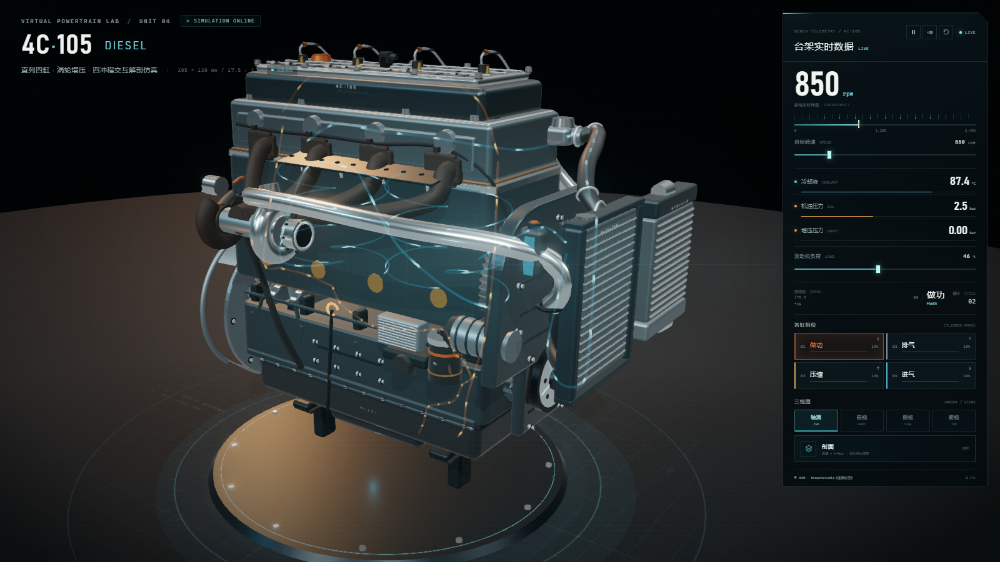
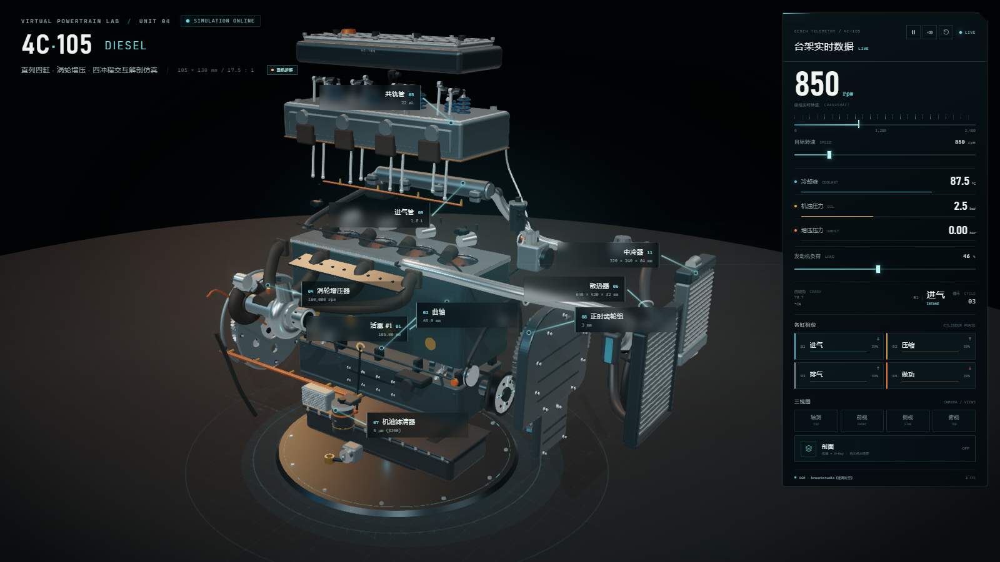
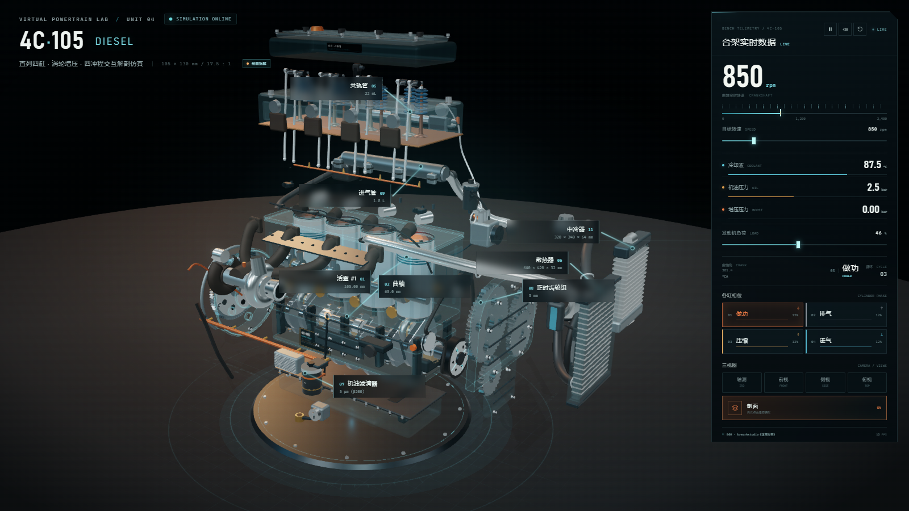
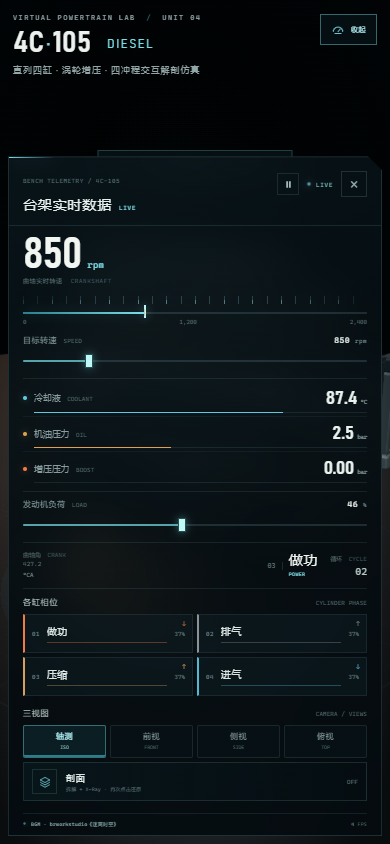

# 4C-105 四冲程柴油机 · 3D 交互仿真

基于 Three.js / WebGL 2 的直列四缸柴油机实时解剖模型，包含曲柄连杆、配气机构、燃油、润滑、冷却、进排气与涡轮系统的程序化建模。单文件运行、离线可用，内嵌背景音乐。

[**下载单文件 HTML**](四冲程柴油机-3D交互仿真.html) · [源码构建](#构建)

## 预览

<p align="center">
  
  
</p>

<p align="center">
  
</p>

<p align="center">
  
</p>

## 功能

- **完整结构**：501 个渲染网格、71 个可拾取零件 ID、约 31.1 万三角面，覆盖缸体、缸盖、油底壳、活塞连杆、曲轴、配气机构、燃油/润滑/冷却/进排气/涡轮及附件。
- **实时四冲程**：1-3-4-2 点火顺序、曲柄连杆严格解算、凸轮轴半速驱动、气门升程与弹簧压缩实时联动。
- **交互信息卡**：悬停零件显示中英文名称、材料、工艺、功能、关键参数和实时运行状态。
- **点击拆解**：点击任意零件，各总成沿三维方向错峰分离，并框选聚焦当前零件；点击周围空白还原整机。
- **剖面拆解**：右侧「剖面」按钮第一次点击进入 X-Ray 半透明拆解，再次点击还原装配。
- **三视图**：轴测、前视、侧视、俯视四种观察方向。
- **台架数据**：实时转速、目标转速、冷却液温度、机油压力、增压压力、负荷、曲轴角与四缸相位。
- **背景音乐**：内嵌 brworkstudio《迷离时空》，循环播放，不随机体暂停。受浏览器自动播放策略限制，首次点击/触摸/按键后开始。

## 快速开始

直接下载并双击根目录的 [四冲程柴油机-3D交互仿真.html](四冲程柴油机-3D交互仿真.html)，使用 Chrome / Edge 打开即可。

- 无需安装、无需服务器。
- 支持 WebGL 2 和硬件加速。
- 文件约 9.9 MB，背景音乐已以 data URI 内嵌，不会产生外部请求。

## 操作

| 操作 | 功能 |
| --- | --- |
| 左键拖拽 / 滚轮 / 右键拖拽 | 旋转 / 缩放 / 平移 |
| 悬停零件 | 查看实时信息卡 |
| 点击零件 | 整机拆解并聚焦 |
| 点击空白 | 还原装配 |
| 剖面 | 拆解 + X-Ray，再次点击还原 |
| 轴测 / 前视 / 侧视 / 俯视 | 切换三视图相机 |
| `Space` / `Esc` | 暂停 / 还原 |
| `1–4` | 切换视图 |
| `X` | 剖面拆解 |
| `R` | 重置仿真 |

## 技术实现

- **渲染**：Three.js r180、PBR 材质、ACES 色调映射、软阴影、Bloom、FXAA。
- **几何**：1 场景单位 = 100 mm；静态网格按刚体合批以降低绘制开销。
- **运动学**：曲柄连杆与配气相位均逐帧实时求解，没有预制动画。
- **拆解**：按总成建立可独立位移的刚体组，包含气缸盖/气门室罩、燃油、润滑、冷却、中冷、进排气/涡轮、附件、正时、飞轮和油底壳。
- **音频**：MP3 以 base64 data URI 内嵌到最终单文件。

## 构建

需要 Node.js、`three@0.180`、`esbuild@0.25`，以及 `assets/bgm.mp3`：

```powershell
npm install three@0.180.0 esbuild@0.25.9 --no-save
node build.mjs --minify
```

生成：

- `四冲程柴油机-3D交互仿真.html` — 单文件交付版
- `index.html` — 同内容网页入口副本

## 项目结构

```text
.
├─ 四冲程柴油机-3D交互仿真.html
├─ README.md
├─ build.mjs
├─ assets/
│  └─ bgm.mp3
├─ shots/
│  ├─ preview-hero.png
│  ├─ preview-exploded.png
│  ├─ preview-section.png
│  └─ preview-mobile-panel.png
└─ src/
   ├─ main.js
   ├─ engine.js
   ├─ simulation.js
   ├─ flow.js
   ├─ materials.js
   ├─ geometry.js
   ├─ parts.js
   ├─ style.css
   └─ index.template.html
```

## 说明

- 视觉模型用于结构原理、运动关系与工程展示，并非 CAD 制造图纸。
- 0.1 mm 为视觉精度目标；部分螺栓、密封件和附件为示意简化。
- 实际帧率取决于 GPU、浏览器和窗口分辨率。
- 背景音乐版权归 **brworkstudio** 所有，仅按用户提供素材内嵌使用。
